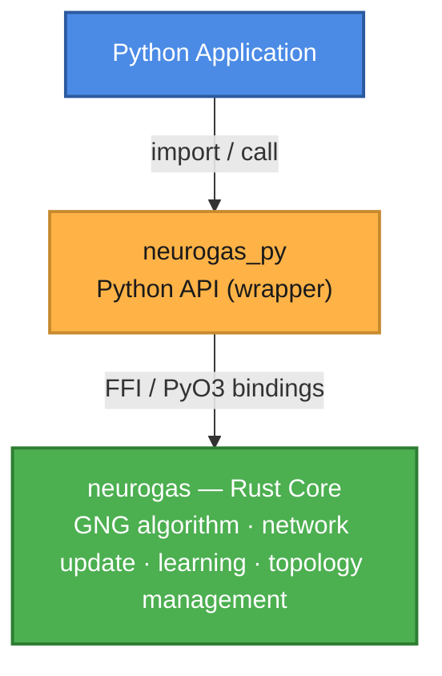

# Neurogas Documentation Server

## Growing Neural Gas (GNG)

A high-performance **Growing Neural Gas** implementation built with a Rust core, exposed through both a native Rust API and a Python wrapper.

---

## Architecture

- **`neurogas`** — The Rust crate. Contains the full GNG algorithm (network growth, weight adaptation, topology updates, edge ageing).
- **`neurogas_py`** — A thin Python binding (via PyO3/FFI) that re-exposes the Rust API with Pythonic ergonomics.

> The Python layer adds **zero algorithmic logic**. All computation lives in Rust.

*Last updated: 2026*

